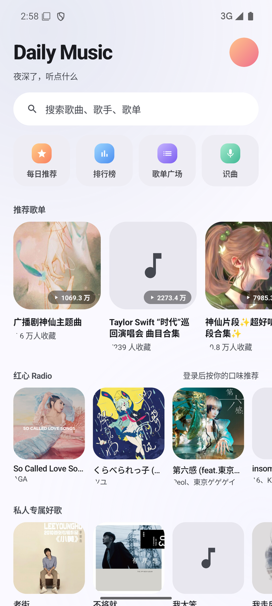
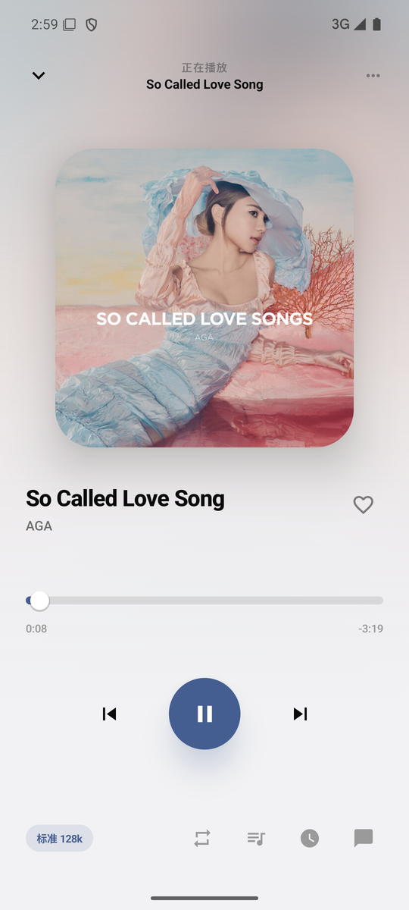
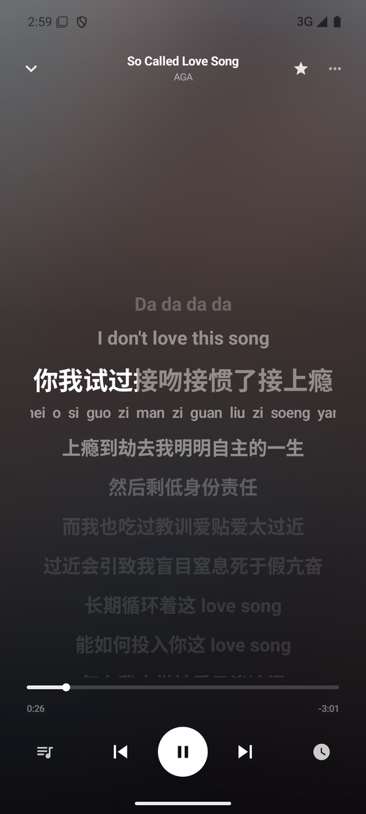
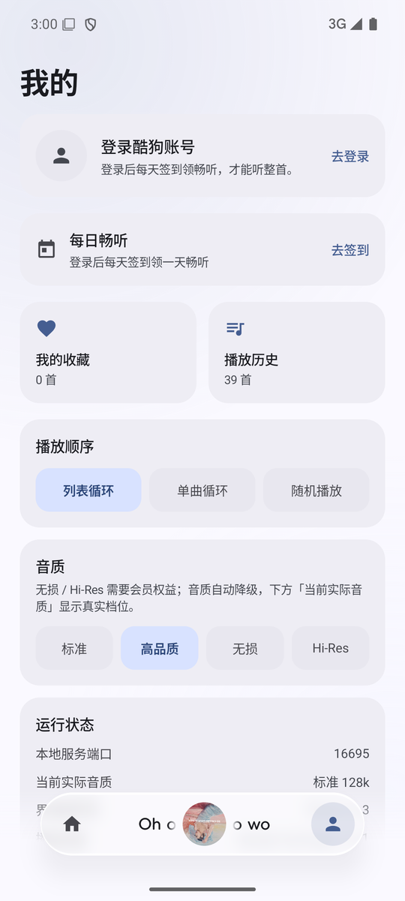
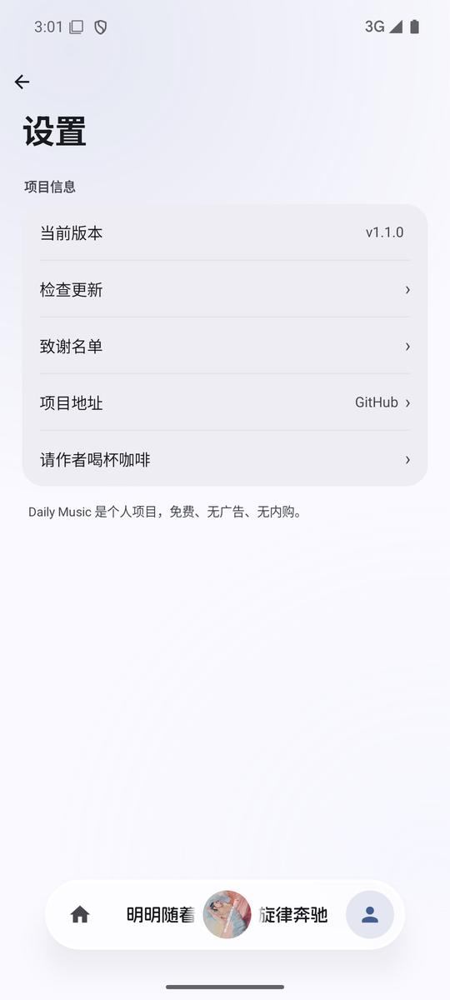
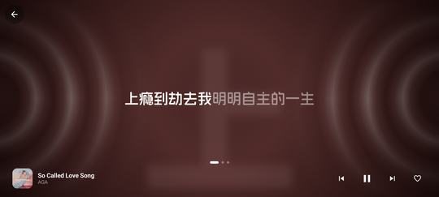
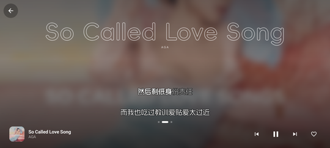
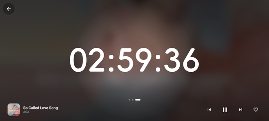

# Daily Music

一款 HyperOS 风格的在线音乐客户端，用 **Kotlin + Jetpack Compose + Miuix** 构建。

同时提供一个独立的 **TV 版**（Android TV / 电视盒子），遥控器即可操作，与手机版是两个不同的 APK，可同时安装。


## 📺 TV 版

面向 Android TV / 电视盒子的独立应用（`com.dailymusic.tv`），10 英尺大屏界面，方向键 + 确认键 + 返回键全程可操作。按处理器架构分两个包，**按你的设备选一个装即可**：

| 设备 | 下载 | 说明 |
|---|---|---|
| 老盒子 / 32 位设备 | [daily-music-tv-1.0.9-32bit.apk](https://github.com/Zxxy326/daily-music/releases/download/tv-v1.0.9/daily-music-tv-1.0.9-32bit.apk) | `armeabi-v7a`，兼容性最好 |
| 新电视 / 64 位设备 | [daily-music-tv-1.0.9-64bit.apk](https://github.com/Zxxy326/daily-music/releases/download/tv-v1.0.9/daily-music-tv-1.0.9-64bit.apk) | `arm64-v8a`，性能更好 |

> 不确定设备位数？两个都试一下，装不上或打开闪退就换另一个。32 位包在任何 64 位设备上也能运行，只是性能略低。

**功能**：首页推荐歌单 / 榜单 / 新歌速递、搜索、曲库与歌手页、我的歌单、播放页与滚动歌词、播放队列 / 音质 / 睡眠定时、扫码登录与签到、设置与检查更新。**三种歌词动效**（播放页工具行「歌词动效」进入，遥控器左右键切换）：

- **动感涟漪** —— 封面取色打底，频谱驱动的左右同心波带，歌词从两侧向中间逐字汇合
- **简约** —— 模糊封面 + 描边歌名，两句歌词一左一右逐字点亮
- **精简时钟** —— 模糊封面 + 辉光，大号时间当背景板

> v1.0.9：已在 MuMu 模拟器联网实测三种动效渲染，并修复播放页工具胶囊重叠、效果切换方向键跳格、效果页返回键失效三个交互问题。

（识曲、评论等移动端功能在 TV 端不做。）

**安装**：把 APK 拷到 U 盘插到电视上，用文件管理器或当贝 / 沙发桌面打开安装；或直接用 adb `adb install xxx.apk`。首次启动若弹出「16KB 分页兼容」提示，选「不再显示」即可，不影响使用。

**TV 版构建**：

```bash
# 分 ABI 各出一个包（需先备好 32/64 位 .so）
./gradlew :tv:assembleRelease
# 产物：tv/build/outputs/apk/release/tv-{armeabi-v7a,arm64-v8a}-release.apk
```

## 界面预览

### 竖屏

| 首页 | 播放页 | 歌词页 |
|---|---|---|
|  |  |  |

| 我的 | 设置 |
|---|---|
|  |  |

### 横屏歌词动效

左右滑动切换，操作区 5 秒自动隐藏。

**动感涟漪** —— 封面取色，频谱驱动的同心波带



**简约** —— 描边歌名，两句歌词一左一右逐字点亮



**精简时钟** —— 模糊封面打底，大号时间当背景板



## 技术栈

| 组件 | 版本 | 说明 |
|---|---|---|
| Gradle | 8.14.3 | |
| AGP | 8.11.0 | |
| Kotlin / Compose 编译器 | 2.4.21 | |
| compileSdk | 37 | Miuix 的 aar-metadata 硬性要求 |
| minSdk | 33 | 玻璃模糊（`miuix-blur`）要求 |
| Miuix | 0.9.3 | 0.9.4 需要 AGP ≥ 9.1，暂不可用 |
| 播放内核 | Media3 ExoPlayer 1.4.1 | `MediaSessionService` + `MediaController` |
| 内嵌服务 | Rust + tiny_http | 复用 md3Music 的 API 服务 |

## 构建

前置：JDK 17、Android SDK（platform 37、build-tools 35）、NDK 27、Rust（含 4 个 android target）。

```bash
# 一键构建（Rust + APK）
./scripts/build.sh

# 只打 APK（.so 已就位时）
./gradlew assembleDebug
```

产物：`app/build/outputs/apk/debug/app-debug.apk`

> **注意**：Rust 交叉编译在受限沙箱中会卡死（clang 子进程无法启动），必须在正常权限下执行。

## 已知约束

- `compileSdk` 必须是 37：Miuix 全部版本（0.9.0–0.9.4）的 aar-metadata 都写着 `minCompileSdk=37`
- AGP 8.11 官方最高推荐 compileSdk 是 36，用 37 依赖 `android.suppressUnsupportedCompileSdk=37`
- 设备需 API 33+ 才能跑玻璃模糊效果
- 加密格式（`.mgg`）曲目不可播，自动跳过
- 签到遇到上游滑块风控（`error_code=20028`）时无法完成，会提示去官方 App 签一次
- `20018` 有歧义：既是「登录过期」，也是「签发身份与请求身份不一致」，还是
  「token 没送到」（query 编码把 `; ` 变成 `;+`，userid 掉了）。排查顺序：
  ① 同一张 token 打 `/user/cloud/playlist` 是否 `status=1`（活了就说明 token 没问题）
  → ② 确认受影响的接口是否依赖 `userid`/`vip_token`（依赖的话看 cookie 拼装）
  → ③ 最后才怀疑凭证本身


## 致谢

这个项目站在很多人的肩膀上：

| 项目 | 作用 |
|---|---|
| [Miuix](https://github.com/miuix-kotlin-multiplatform/miuix) | HyperOS 风格的 Compose 组件库 |
| [AndroidX Media3 / ExoPlayer](https://github.com/androidx/media) | 播放内核（`MediaSessionService` + `MediaController`） |
| [JNA](https://github.com/java-native-access/jna) | 直接调用 Rust 导出的 C 符号，绕开 JNI 包名耦合 |
| [md3Music](https://github.com/zzyoxml/md3Music) | 上游的 Rust 服务与接口实现 |
| 阿里妈妈方圆体 | 底栏与歌词动效页的字体，阿里巴巴免费商用字体，本项目按 GB2312 子集化后打包 |

歌词相关实现参考：

| 项目 | 参考内容 |
|---|---|
| [apple-music-like-lyrics](https://github.com/Steve-xmh/applemusic-like-lyrics) | Apple Music 风格逐字歌词渲染 |

还有每一个愿意把歌听完的人。

## 请作者喝杯咖啡

Daily Music 完全免费，没有广告，也没有内购。
如果它帮你省下了一个会员，或者只是让你听歌时心情好了一点，欢迎请作者喝杯咖啡。

<p align="center">
  
</p>


## 许可证与免责声明

- `rust/kugou_server/` 来自 [md3Music](https://github.com/zzyoxml/md3Music)，**AGPL-3.0**，原始许可证见 `rust/kugou_server/LICENSE-AGPL.txt`。本项目作为其衍生作品，整体按 AGPL-3.0 分发。
- 项目对接的是**非官方**接口，涉及的音乐内容版权归原权利人所有。仅供个人学习与自用，**请勿用于商业用途或公开分发**。
- 使用本项目产生的一切后果由使用者自行承担。
