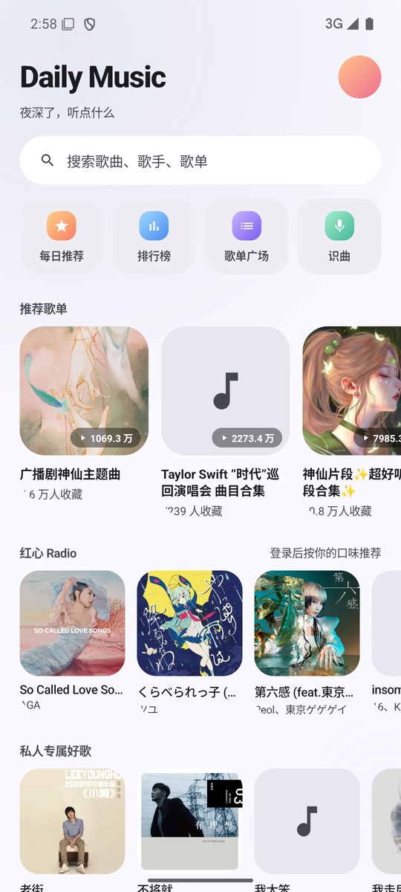
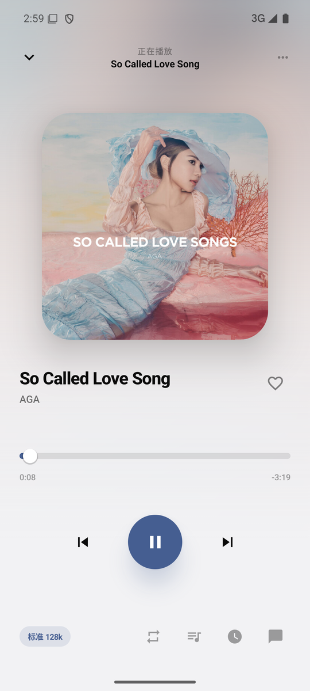
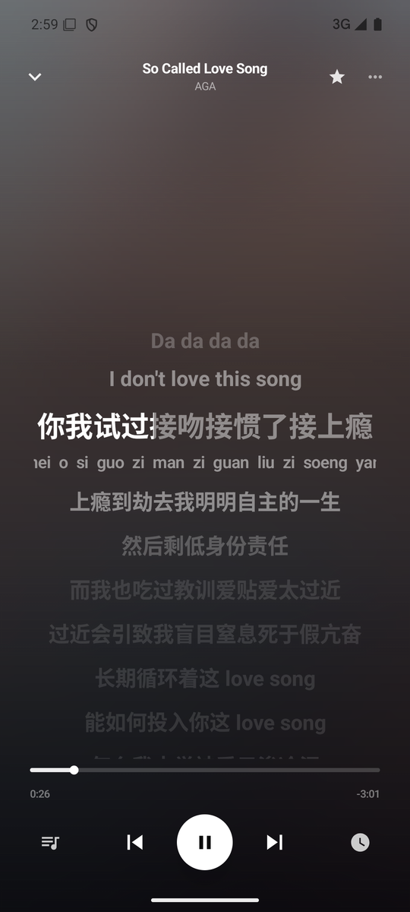
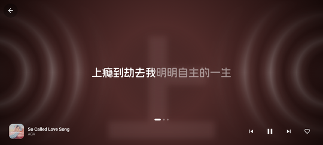
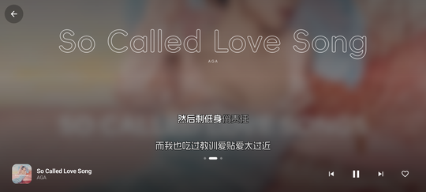
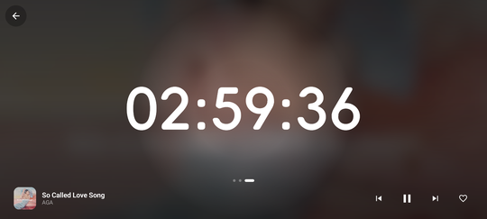
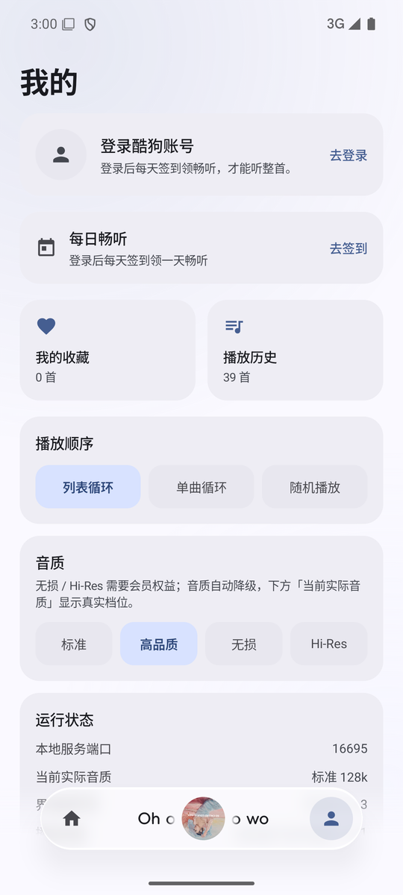
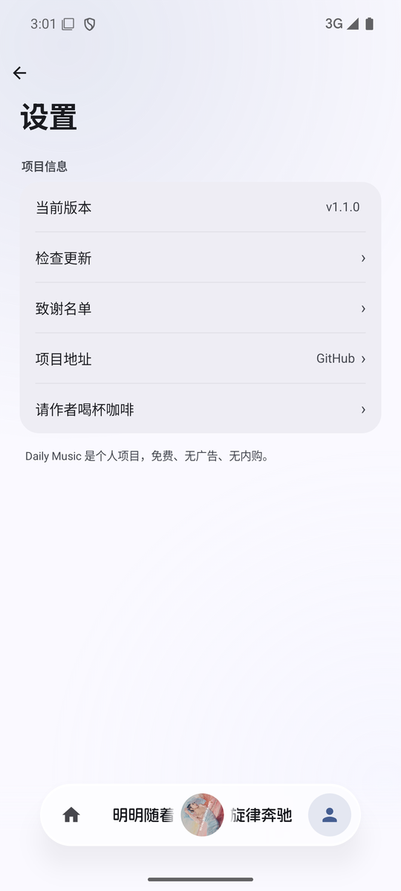

# Daily Music

一款 HyperOS 风格的在线音乐客户端，用 **Kotlin + Jetpack Compose + Miuix** 构建。


## 界面预览

| 首页 | 播放页 | 歌词页 |
|---|---|---|
|  |  |  |

| 动感涟漪 | 简约 | 精简时钟 |
|---|---|---|
|  |  |  |

| 我的 | 设置 |
|---|---|
|  |  |

> 横屏歌词动效有三套：动感涟漪（封面取色 + 频谱驱动的同心波带）、
> 简约（描边歌名 + 两句歌词一左一右逐字点亮）、精简时钟（大号时间当背景板）。
> 左右滑动切换，操作区 5 秒自动隐藏。

## 技术栈

| 组件 | 版本 | 说明 |
|---|---|---|
| Gradle | 8.14.3 | |
| AGP | 8.11.0 | |
| Kotlin / Compose 编译器 | 2.4.21 | |
| compileSdk | 37 | Miuix 的 aar-metadata 硬性要求 |
| minSdk | 33 | 玻璃模糊（`miuix-blur`）要求 |
| Miuix | 0.9.3 | 0.9.4 需要 AGP ≥ 9.1，暂不可用 |
| 播放内核 | Media3 ExoPlayer 1.4.1 | `MediaSessionService` + `MediaController` |
| 内嵌服务 | Rust + tiny_http | 复用 md3Music 的酷狗 API 服务 |

## 构建

前置：JDK 17、Android SDK（platform 37、build-tools 35）、NDK 27、Rust（含 4 个 android target）。

```bash
# 一键构建（Rust + APK）
./scripts/build.sh

# 只打 APK（.so 已就位时）
./gradlew assembleDebug
```

产物：`app/build/outputs/apk/debug/app-debug.apk`

> **注意**：Rust 交叉编译在受限沙箱中会卡死（clang 子进程无法启动），必须在正常权限下执行。

## 已知约束

- `compileSdk` 必须是 37：Miuix 全部版本（0.9.0–0.9.4）的 aar-metadata 都写着 `minCompileSdk=37`
- AGP 8.11 官方最高推荐 compileSdk 是 36，用 37 依赖 `android.suppressUnsupportedCompileSdk=37`
- 设备需 API 33+ 才能跑玻璃模糊效果
- 加密格式（`.mgg`）曲目不可播，自动跳过
- 签到遇到上游滑块风控（`error_code=20028`）时无法完成，会提示去官方 App 签一次
- `20018` 有歧义：既是「登录过期」，也是「签发身份与请求身份不一致」，还是
  「token 没送到」（query 编码把 `; ` 变成 `;+`，userid 掉了）。排查顺序：
  ① 同一张 token 打 `/user/cloud/playlist` 是否 `status=1`（活了就说明 token 没问题）
  → ② 确认受影响的接口是否依赖 `userid`/`vip_token`（依赖的话看 cookie 拼装）
  → ③ 最后才怀疑凭证本身


## 致谢

这个项目站在很多人的肩膀上：

| 项目 | 作用 |
|---|---|
| [Miuix](https://github.com/miuix-kotlin-multiplatform/miuix) | HyperOS 风格的 Compose 组件库，界面的玻璃、开关、按钮都靠它 |
| [AndroidX Media3 / ExoPlayer](https://github.com/androidx/media) | 播放内核（`MediaSessionService` + `MediaController`） |
| [JNA](https://github.com/java-native-access/jna) | 直接调用 Rust 导出的 C 符号，绕开 JNI 包名耦合 |
| [md3Music](https://github.com/zzyoxml/md3Music) | 上游的 Rust 服务与酷狗接口实现，本项目的接口层与它逐行对齐 |
| 阿里妈妈方圆体 | 底栏与歌词动效页的字体，阿里巴巴免费商用字体，本项目按 GB2312 子集化后打包 |
| 酷狗概念版 | 音源与账号能力（非官方接口，仅供学习研究） |

还有每一个愿意把歌听完的人。

## 请作者喝杯咖啡

Daily Music 完全免费，没有广告，也没有内购。
如果它帮你省下了一个会员，或者只是让你听歌时心情好了一点，欢迎请作者喝杯咖啡。

<p align="center">
  
</p>


## 许可证与免责声明

- `rust/kugou_server/` 来自 [md3Music](https://github.com/zzyoxml/md3Music)，**AGPL-3.0**，原始许可证见 `rust/kugou_server/LICENSE-AGPL.txt`。本项目作为其衍生作品，整体按 AGPL-3.0 分发。
- 项目对接的是**非官方**酷狗接口，涉及的音乐内容版权归原权利人所有。仅供个人学习与自用，**请勿用于商业用途或公开分发**。
- 使用本项目产生的一切后果由使用者自行承担。
